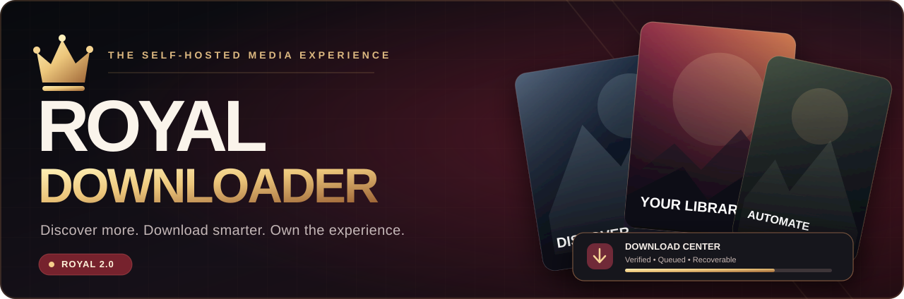
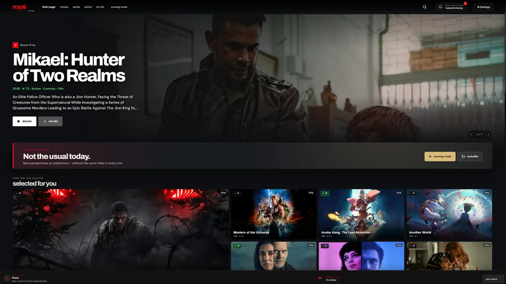
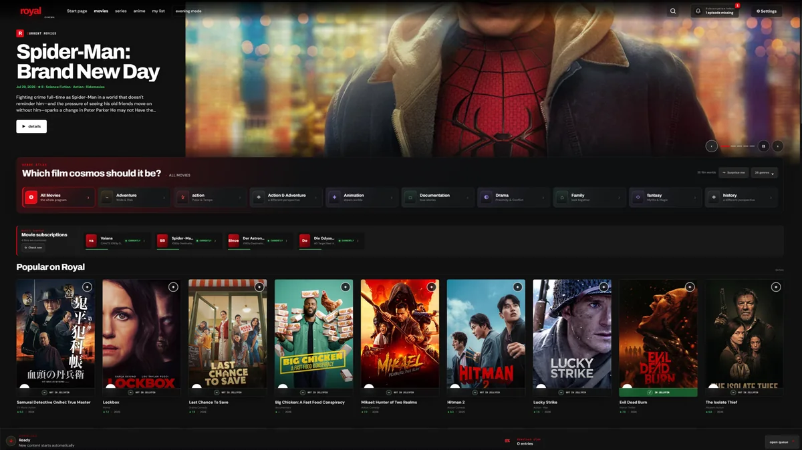
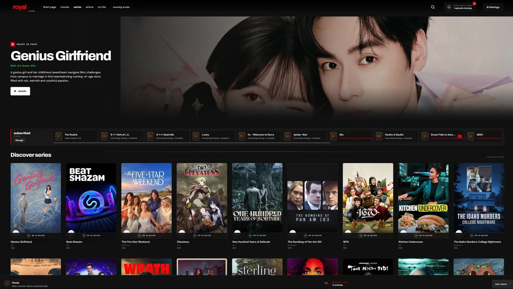
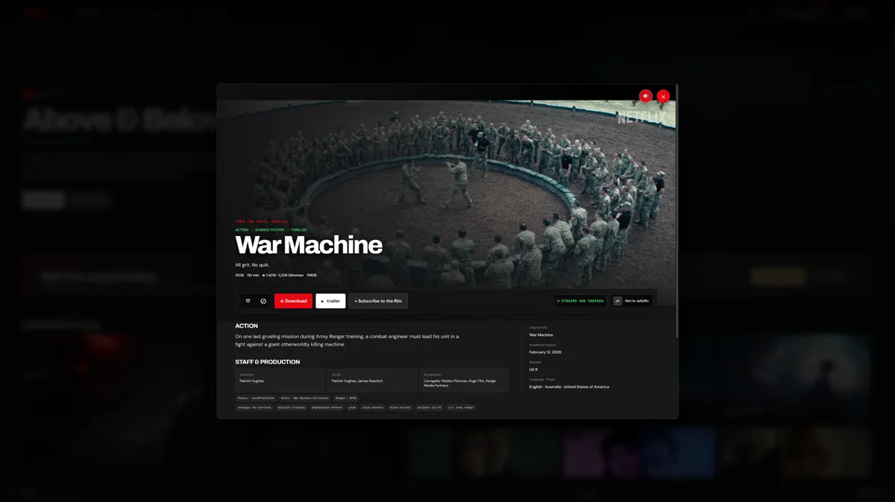
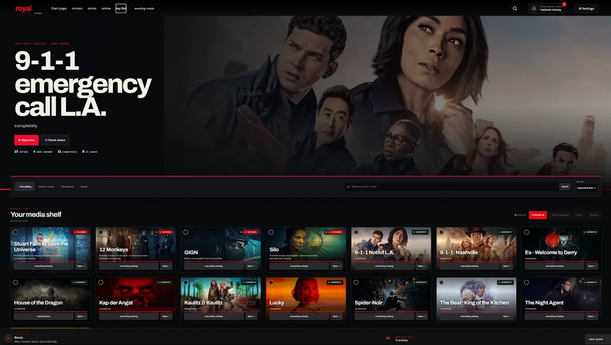
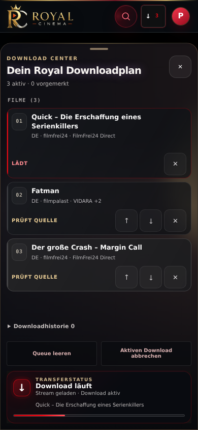
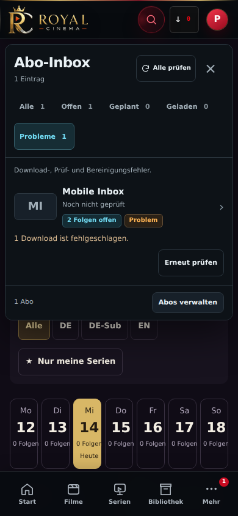

<p align="center">
  
</p>

<h3 align="center">Your media. Your rules. One beautiful control center.</h3>

<p align="center">
  Discover movies and series, manage download requests, automate what comes next,<br />
  and keep your Jellyfin library connected — from your browser, phone or NAS.
</p>

<p align="center">
  <a href="https://github.com/TimeLance89/RoyalDownloader/releases/tag/v2.0.2"></a>
  <a href="https://github.com/TimeLance89/RoyalDownloader/actions/workflows/quality.yml"></a>
  <a href="docs/DOCKER.md"></a>
  <a href="LICENSE"></a>
</p>

<p align="center">
  <a href="#quick-start"><strong>Get started</strong></a> ·
  <a href="#explore-royal">Explore Royal</a> ·
  <a href="#a-look-inside">Screenshots</a> ·
  <a href="#whats-new-in-20">Version 2.0</a> ·
  <a href="#documentation">Documentation</a>
</p>

---

## Meet your new media command center

RoyalDownloader is a **self-hosted media discovery and download manager** built for
people who want one place to browse, request, track and organize their movie and
series library. It combines a responsive web interface, a restart-aware download
queue, configurable source resolution and deep Jellyfin integration.

**One app, from discovery to library.** Browse with TMDB metadata, verify what
is already available in Jellyfin, select an eligible source, follow progress,
and keep the result in your own storage.

<p align="center">
  <a href="docs/assets/screenshots/home-desktop.webp">
    
  </a>
  <br />
  <sub>RoyalDownloader home screen · real project screenshot</sub>
</p>

## Explore Royal

<table>
<tr>
<td width="50%" valign="top">
  <p><strong>🎬 Discover</strong></p>
  <p>Explore movies, series and anime in one place, with global search,
  TMDB artwork, recommendations, cast filmographies and personal discovery.
  Language-aware source checks help separate <strong>verified audio</strong>
  from subtitles.</p>
</td>
<td width="50%" valign="top">
  <p><strong>⬇️ Download</strong></p>
  <p>Track live transfers, source activity, retries and history in a persistent
  queue. Where supported, direct HTTP downloads resume from
  <strong>validated checkpoints</strong> instead of starting blindly from zero.</p>
</td>
</tr>
<tr>
<td valign="top">
  <p><strong>👑 Personalize</strong></p>
  <p>Give household members separate profiles, taste signals, recommendations
  and saved media requests. Jellyfin links are <strong>per profile</strong>;
  actual download jobs and media storage are shared by the server.</p>
</td>
<td valign="top">
  <p><strong>📺 Connect Jellyfin</strong></p>
  <p>Check library availability before requesting media, show owned titles
  in the catalog, reconcile watched content and keep personal Jellyfin lists
  in sync with playable files.</p>
</td>
</tr>
<tr>
<td valign="top">
  <p><strong>⚡ Automate</strong></p>
  <p>Follow new episodes and movie-quality targets, configure download windows,
  accept Telegram requests and integrate with <strong>Seerr / Moonfin</strong>
  for supported media-request flows.</p>
</td>
<td valign="top">
  <p><strong>🛡️ Recover</strong></p>
  <p>Protect queue snapshots, isolate provider failures, inspect source health
  and use versioned updates with verification and rollback. Docker's
  independent startup guard requires an updated container image.</p>
</td>
</tr>
</table>

> [!TIP]
> **Royal Intelligence** learns from each household member's own interactions
> and Jellyfin signals. Optional, locally hosted **Ollama** can rank existing
> discovery candidates; it does not decide which providers to use or manage
> your files. [Explore personal discovery](docs/PERSONALIZATION.md) ·
> [Royal Reflex](docs/ROYAL_REFLEX.md)

## A look inside

<table>
<tr>
<td width="50%">
  <a href="docs/assets/screenshots/movies-overview.webp"></a>
</td>
<td width="50%">
  <a href="docs/assets/screenshots/series-overview.webp"></a>
</td>
</tr>
<tr>
<td align="center"><strong>Movies & recommendations</strong></td>
<td align="center"><strong>Series & subscriptions</strong></td>
</tr>
<tr>
<td>
  <a href="docs/assets/screenshots/movie-details.webp"></a>
</td>
<td>
  <a href="docs/assets/screenshots/my-list-archive.webp"></a>
</td>
</tr>
<tr>
<td align="center"><strong>Media details</strong></td>
<td align="center"><strong>Saved media & archive</strong></td>
</tr>
</table>

### A download center made for your phone

The mobile Download Center adds focused artwork, compact queue cards,
progress and source activity, plus touch-friendly actions. The subscription
inbox stays accessible from the mobile navigation.

<div align="center">
<table>
<tr>
<td width="50%" align="center"></td>
<td width="50%" align="center"></td>
</tr>
<tr>
<td align="center"><strong>Download Center 2.0</strong></td>
<td align="center"><strong>Subscription inbox</strong></td>
</tr>
</table>
</div>

<sub>Gallery images come from checked-in browser captures. The mobile examples use deterministic offline content and artwork fixtures; actual content and appearance may differ.</sub>

## What's new in 2.0

RoyalDownloader 2.0 is a major **product milestone**, not an intentional
breaking API or stored-data migration.

| Experience | Improvements |
| --- | --- |
| **Smoother navigation** | More responsive browsing, bounded background work and improved series catalog loading |
| **Modern mobile experience** | Cinematic Download Center, clearer transfer states, faster-feeling navigation and subscription inbox access |
| **More reliable downloads** | Resume-safe direct HTTP/MP4 checkpoints, robust queue persistence, provider retries and worker recovery |
| **Jellyfin clarity** | Catalog ownership ribbons, episode-inventory checks, per-profile saved media and better library status |
| **Safer upgrades** | Revision verification, independent Docker startup guard, recoverable versioned runtime and rollback |
| **More confidence** | Expanded browser, WebKit, security, performance and persistence regression coverage |

Read the [v2.0.2 release notes](docs/releases/v2.0.2.md) or the
[full changelog](CHANGELOG.md).

## How it works

```text
       DISCOVER              VERIFY                 DOWNLOAD
  Movies · Series      TMDB · Jellyfin         Resolve · Queue
      · Anime             · Sources            Transfer · Check
          │                   │                      │
          └───────────────────┴──────────────────────┘
                              │
                      YOUR MEDIA LIBRARY
                              │
                Jellyfin · Profiles · Automation
```

RoyalDownloader does not guarantee a stream exists, is reachable, or has a
requested audio track. Source providers and metadata services are external
and can change independently. A subtitle label is **not** evidence of
spoken German audio.

## Quick start

### Docker Compose · recommended for NAS and home servers

You'll need **Docker Engine**, **Docker Compose v2**, a **TMDB API key/read
token** for first-run setup, and writable persistent movie and series folders.

**1. Clone the Stable branch and prepare the environment.**

```bash
git clone https://github.com/TimeLance89/RoyalDownloader.git
cd RoyalDownloader
cp .env.example .env
mkdir -p data runtime
```

For a reproducible, version-pinned installation, use an
[official release tag](https://github.com/TimeLance89/RoyalDownloader/releases)
rather than following `main`.

**2. Edit `.env` and set your actual host storage paths.**

```dotenv
PUID=1000
PGID=1000
MOVIES_HOST_DIR=/absolute/path/to/Movies
SERIES_HOST_DIR=/absolute/path/to/Series
```

The configured user must have write access to both media folders and to
`data/` and `runtime/`. Preserve any custom credentials, mappings and
settings when upgrading an existing installation.

**3. Build, start and check the application.**

```bash
docker compose config --quiet
docker compose up -d --build
docker compose logs --tail=50 seriendownloader
curl --fail http://127.0.0.1:8765/api/health
```

Open **`http://<NAS-IP>:8765`** from a device on your local network
(or `http://localhost:8765` on the Docker host), then complete the
guided setup. It configures your account, content languages, providers,
storage and optional integrations.

> [!IMPORTANT]
> Do **not** expose port `8765` directly to the public internet.
> Use authenticated access with a carefully configured reverse proxy or
> secure tunnel for remote access. Never commit `.env`, cookies, access
> tokens or the contents of `data/`.

<details>
<summary><strong>Windows desktop</strong></summary>

Install Python 3.12+ and a supported Chrome/Chromium browser. Clone or
download the project and run [`start_windows.cmd`](start_windows.cmd).
The launcher prepares dependencies and starts the local web interface.

For development or manual startup:

```powershell
py -3 -m pip install -r requirements.lock
py -3 server.py
```

Select **Regular computer** during onboarding and choose local storage folders.

</details>

<details>
<summary><strong>Linux / macOS desktop</strong></summary>

With Python 3.12+, Chrome/Chromium and the platform's media dependencies
available:

```bash
git clone https://github.com/TimeLance89/RoyalDownloader.git
cd RoyalDownloader
python3 -m pip install -r requirements.lock
python3 server.py
```

Select **Regular computer** during onboarding.

</details>

<details>
<summary><strong>Mounted-source NAS installation</strong></summary>

Existing NAS setups that mount the source folder into a Python container
can continue to use [`start.sh`](start.sh). That deployment mode installs
Chromium/ffmpeg dependencies and uses versioned runtime paths. Follow
[the NAS guide](docs/DOCKER.md#deployment-a-mounted-source-folder-with-startsh)
for the correct image, mounts and startup command.

</details>

## Built for the long run

| | Desktop | NAS / home server |
| --- | --- | --- |
| **Typical use** | On-demand local use | Always-on home media management |
| **Interface** | Local browser | Web UI from devices on the LAN |
| **Launcher** | Windows launcher or Python | Docker Compose or mounted-source `start.sh` |
| **Storage** | Local folders | Explicit persistent media mounts |

**A few principles behind Royal:**

- **Persistent means persistent.** Keep `.env`, `data/` and `runtime/`
  backed up. Never treat those directories as disposable container data.
- **Verification before action.** Downloads use source and language checks
  where available; the updater checks the precise revision and required CI.
- **A clear line between profiles and storage.** Personal preferences and
  saved lists are separate; the underlying queue and files belong to the
  shared server.
- **Control over automation.** Provider health, scheduling, optional privacy
  egress and [Storage Autopilot](docs/STORAGE_AUTOPILOT.md) have explicit
  settings and safety boundaries.

For Stable / Overnight switching, backup procedures and rollback, see
[Update channels](docs/UPDATE_CHANNELS.md) and
[Release operations](docs/RELEASE.md).

## Integrations

| Service | Role |
| --- | --- |
| [**TMDB**](https://www.themoviedb.org/) | Metadata, titles, artwork, cast and discovery; credentials required during setup |
| **Jellyfin** | Library inventory, playback feedback, personal lists and scans |
| **Seerr / Moonfin** | Approved movie/series requests, including supported Fire TV workflows |
| **Telegram** | Requests, queue status and notifications |
| **Ollama (optional)** | Local ranking of existing discovery candidates |
| **GitHub** | Checked Stable / Overnight updates, changelogs and revision comparisons |

All external integrations operate according to their own terms and availability.
The core application runs on infrastructure you control; third-party metadata,
providers and enabled integrations still make outbound requests.

## Documentation

| I want to… | Read |
| --- | --- |
| **Deploy on a NAS or configure Docker** | [Docker & NAS guide](docs/DOCKER.md) |
| **Update safely or restore a previous version** | [Release & rollback guide](docs/RELEASE.md) |
| **Switch between Stable and Overnight** | [Update channel guide](docs/UPDATE_CHANNELS.md) |
| **Understand queue recovery and persistent jobs** | [Queue jobs](docs/QUEUE_JOBS.md) · [HTTP resume](docs/HTTP_MP4_RESUME.md) |
| **Set up Jellyfin recommendations and profiles** | [Jellyfin](docs/JELLYFIN_RECOMMENDER.md) · [Personalization](docs/PERSONALIZATION.md) |
| **Configure provider/source languages** | [Provider languages](docs/PROVIDER_LANGUAGES.md) |
| **Understand storage automation** | [Storage Autopilot](docs/STORAGE_AUTOPILOT.md) |
| **Integrate clients or contribute code** | [API](docs/ANDROID_API.md) · [Architecture](docs/ARCHITECTURE.md) · [Contributing](CONTRIBUTING.md) |
| **Find more technical documentation** | [Documentation index](docs/README.md) |

## Responsible use & security

RoyalDownloader is a self-hosted **management tool**, not a catalog of
guaranteed media. Access and store only content you have the right to use,
and comply with applicable laws and third-party terms.

For vulnerabilities, follow [SECURITY.md](SECURITY.md) rather than opening
a public issue. For regular bugs and contributions, see
[CONTRIBUTING.md](CONTRIBUTING.md). Remove secrets, personal data and private
network information from public logs or screenshots.

---

<p align="center">
  <strong>Built for your library. Designed for your home.</strong><br />
  RoyalDownloader is open source under the <a href="LICENSE">Apache License 2.0</a>.<br />
  See <a href="NOTICE">NOTICE</a> for attribution.<br />
  <a href="https://github.com/TimeLance89/RoyalDownloader/releases">Releases</a> ·
  <a href="CHANGELOG.md">Changelog</a> ·
  <a href="https://github.com/TimeLance89/RoyalDownloader/issues">Report an issue</a> ·
  <a href="#">Back to top</a>
</p>
