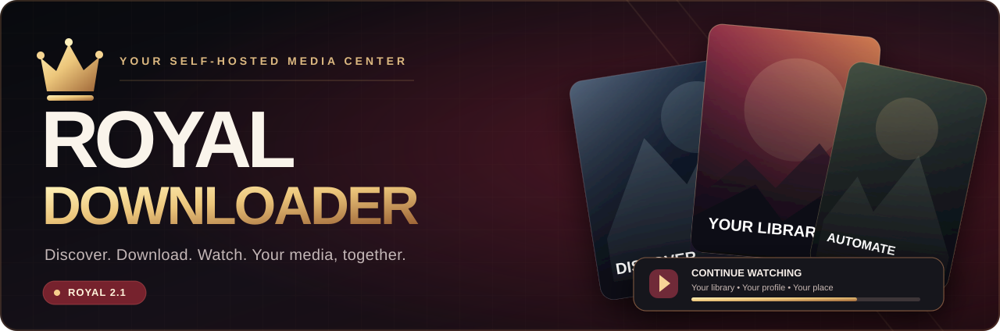
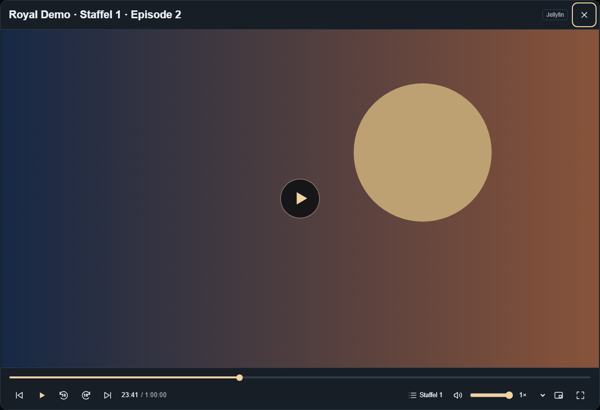
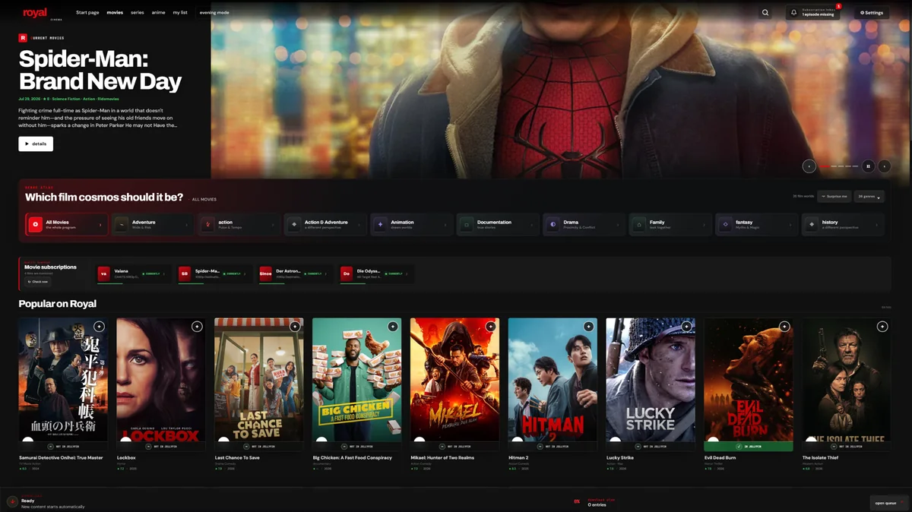
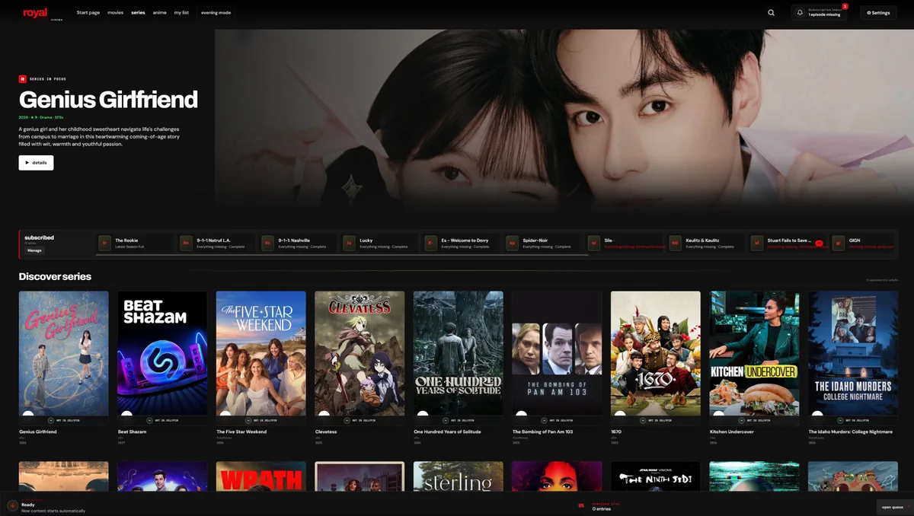
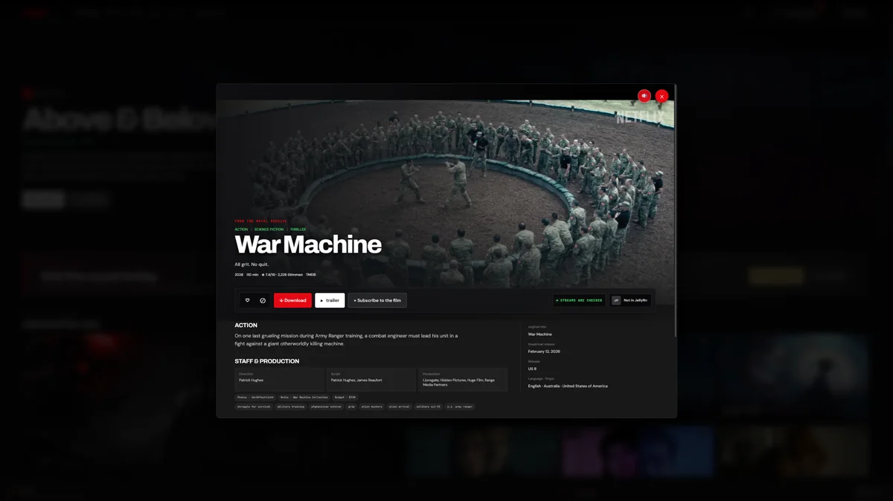
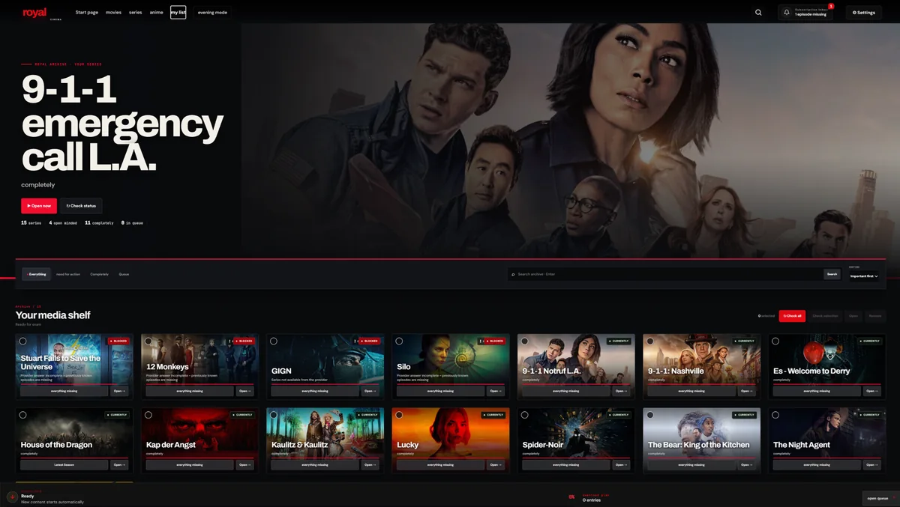
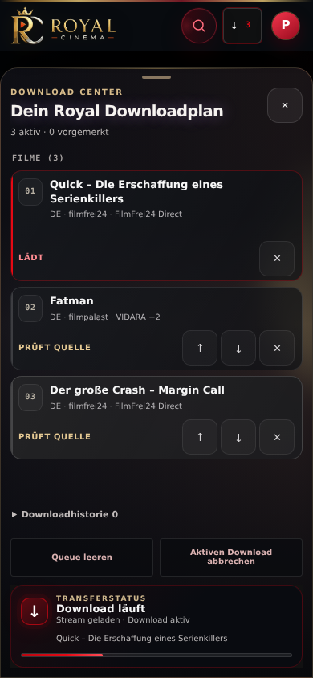
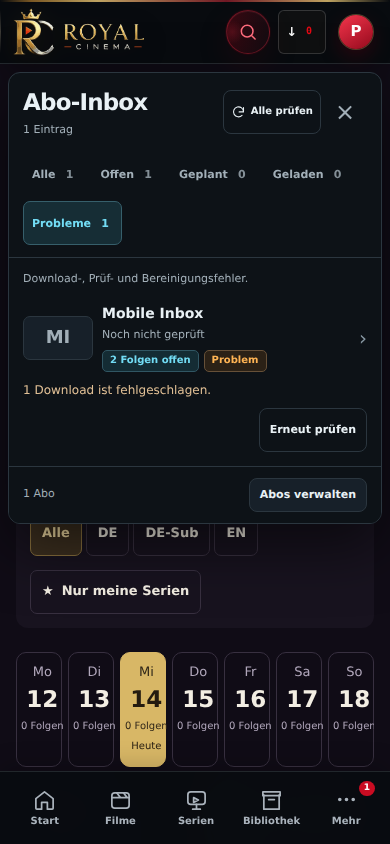

<p align="center">
  
</p>

<h3 align="center">Discover. Download. Press play.</h3>

<p align="center">
  Your self-hosted media center for movies, series and anime.<br />
  Find something to watch, bring it into your library and play it directly in Royal.
</p>

<p align="center">
  <a href="https://github.com/TimeLance89/RoyalDownloader/releases/tag/v2.1.0"></a>
  <a href="https://github.com/TimeLance89/RoyalDownloader/actions/workflows/quality.yml"></a>
  <a href="docs/DOCKER.md"></a>
  <a href="LICENSE"></a>
</p>

<p align="center">
  <a href="#watch-directly-in-royal"><strong>Watch in Royal</strong></a> ·
  <a href="#quick-start">Get started</a> ·
  <a href="#a-look-inside">Screenshots</a> ·
  <a href="#whats-new-in-21">Version 2.1</a> ·
  <a href="#documentation">Documentation</a>
</p>

---

## Your library, from discovery to playback

RoyalDownloader is a **self-hosted media center** that brings discovery,
downloads, personal libraries and **direct browser playback** together. Run it
on your NAS or home server and use the same web interface from your computer,
phone or tablet.

**Version 2.1 completes the journey.** Royal helps you find a film or series,
check your existing library, acquire missing content and then watch available
Jellyfin media without leaving Royal. The download queue, subscriptions,
language checks and storage automation remain part of that experience.

Jellyfin supplies the library, media streams, transcoding and personal watched
state. Royal supplies the interface that connects discovering, downloading and
watching. Each household member can use their own linked Jellyfin profile.

<p align="center">
  <a href="docs/assets/screenshots/player-v2.1.png">
    
  </a>
  <br />
  <sub>The Royal player · captured from the real interface with deterministic offline demo artwork and episode data</sub>
</p>

## Watch directly in Royal

### Open a title. Start watching.

An available film gets a play button in its detail view. Partly watched titles
show **Continue watching with the saved time**, so you can pick up where you
left off. Playback opens in Royal's own player, with the film title or the
series name, season and episode shown above the video.

The player includes a seekable timeline with elapsed and total time,
10-second skips, volume and speed controls, keyboard shortcuts and a dedicated
fullscreen presentation. Fullscreen controls fade during playback and return
when you move the pointer or use the keyboard. Picture-in-picture is available
where the browser supports it.

### Your next episode is already there

Series details bring the **available Jellyfin seasons and episodes** into one
view, alongside the download experience for missing content. Choose a season,
inspect episode progress and start an available episode directly.

While watching, move to the previous or next available episode, open the episode
menu and switch between seasons. Navigation uses your linked profile's library;
a missing episode is not silently replaced by a different one.

### Continue watching, your way

A personal **Continue watching** carousel sits at the top of Home. Each card
shows the saved position; series cards also identify the episode. Start it with
one click, or open its action menu:

| Action | What happens |
| --- | --- |
| **Continue watching** | Opens the player at your saved Jellyfin position |
| **Open details** | Opens the matching movie or series with its available library content |
| **Remove from Continue watching** | Hides the entry from your Royal list and keeps the saved position |
| **Mark as watched** | Updates your linked Jellyfin profile's watched state |
| **Undo** | Reverses a recent supported list action while its undo option is available |

Removing a card does not delete the media file. Progress is saved to the linked
Jellyfin profile, so playback and the personal list use that profile's state.

### A player for your household

Both enabled **members and administrators** can watch. Each Royal account needs
a linked Jellyfin profile with playback permission and access to the chosen
film or episode. Use separate Jellyfin profiles for separate progress; two Royal
accounts linked to the same Jellyfin profile share that profile's watched state.

Server credentials stay on the Royal server. Playback requests, stream resources
and progress updates are checked against the current account and linked profile.
Changing accounts or the media-center connection clears the previous player's
personal context.

**Ready to watch?** Follow [the media-center setup guide](docs/MEDIA_CENTER.md).
Direct browser playback in this release uses **Jellyfin**. The optional Plex
integration continues to cover supported library and request workflows.

## Explore Royal

<table>
<tr>
<td width="50%" valign="top">
  <p><strong>🎬 Discover</strong></p>
  <p>Explore movies, series and anime in one place, with global search,
  TMDB artwork, recommendations, cast filmographies and personal discovery.
  Language-aware source checks help separate <strong>verified audio</strong>
  from subtitles.</p>
</td>
<td width="50%" valign="top">
  <p><strong>⬇️ Download</strong></p>
  <p>Track live transfers, source activity, retries and history in a persistent
  queue. Where supported, direct HTTP downloads resume from
  <strong>validated checkpoints</strong> instead of starting blindly from zero.</p>
</td>
</tr>
<tr>
<td valign="top">
  <p><strong>👑 Personalize</strong></p>
  <p>Give household members separate profiles, taste signals, recommendations
  and saved media requests. Jellyfin links are <strong>per profile</strong>;
  actual download jobs and media storage are shared by the server.</p>
</td>
<td valign="top">
  <p><strong>▶️ Watch in Royal</strong></p>
  <p>Play available Jellyfin films and episodes in Royal, resume your own
  progress, navigate seasons and keep <strong>Continue watching</strong>
  personal to your linked profile.</p>
</td>
</tr>
<tr>
<td valign="top">
  <p><strong>⚡ Automate</strong></p>
  <p>Follow new episodes and movie-quality targets, configure download windows,
  accept Telegram requests and integrate with <strong>Seerr / Moonfin</strong>
  for supported media-request flows.</p>
</td>
<td valign="top">
  <p><strong>🛡️ Recover</strong></p>
  <p>Protect queue snapshots, isolate provider failures, inspect source health
  and use versioned updates with verification and rollback. Docker's
  independent startup guard requires an updated container image.</p>
</td>
</tr>
</table>

> [!TIP]
> **Royal Intelligence** learns from each household member's own interactions
> and Jellyfin signals. Optional, locally hosted **Ollama** can rank existing
> discovery candidates; it does not decide which providers to use or manage
> your files. [Explore personal discovery](docs/PERSONALIZATION.md) ·
> [Royal Reflex](docs/ROYAL_REFLEX.md)

## A look inside

<table>
<tr>
<td width="50%">
  <a href="docs/assets/screenshots/movies-overview.webp"></a>
</td>
<td width="50%">
  <a href="docs/assets/screenshots/series-overview.webp"></a>
</td>
</tr>
<tr>
<td align="center"><strong>Movies & recommendations</strong></td>
<td align="center"><strong>Series & subscriptions</strong></td>
</tr>
<tr>
<td>
  <a href="docs/assets/screenshots/movie-details.webp"></a>
</td>
<td>
  <a href="docs/assets/screenshots/my-list-archive.webp"></a>
</td>
</tr>
<tr>
<td align="center"><strong>Media details</strong></td>
<td align="center"><strong>Saved media & archive</strong></td>
</tr>
</table>

### A download center made for your phone

The mobile Download Center adds focused artwork, compact queue cards,
progress and source activity, plus touch-friendly actions. The subscription
inbox stays accessible from the mobile navigation.

<div align="center">
<table>
<tr>
<td width="50%" align="center"></td>
<td width="50%" align="center"></td>
</tr>
<tr>
<td align="center"><strong>Download Center 2.0</strong></td>
<td align="center"><strong>Subscription inbox</strong></td>
</tr>
</table>
</div>

<sub>Gallery images come from checked-in browser captures. The mobile examples use deterministic offline content and artwork fixtures; actual content and appearance may differ.</sub>

## What's new in 2.1

**v2.1.0 is the media-center release:** Royal now connects browsing and acquiring
content with watching your own library. The version introduces no intentional
breaking change to the existing API or persistent-data contracts.

| Experience | New in this release |
| --- | --- |
| **Watch in the browser** | Integrated film and episode player, Jellyfin-negotiated direct play or HLS, seeking, fullscreen and supported picture-in-picture |
| **Pick up where you stopped** | Saved-time play buttons, personal Continue watching carousel and progress written back to Jellyfin |
| **Browse your series** | Library-aware series details, seasons, episodes and in-player previous/next navigation |
| **Manage the list** | Open details, hide an entry, mark it watched and undo recent supported actions |
| **Share Royal with your household** | Playback for members and administrators, checked against each account's linked Jellyfin profile |
| **Keep playback isolated** | Private stream sessions and resources, permission checks and account/profile-change handling |
| **Read existing segment metadata** | Authenticated backend access to Jellyfin Intro/Outro markers for clients; no new skip controls in the web player |
| **Reliable storage confirmation** | Unchanged storage polling preserves the button being clicked instead of losing the confirmation |

Read the [v2.1.0 release notes](docs/releases/v2.1.0.md),
[media-center guide](docs/MEDIA_CENTER.md) or [full changelog](CHANGELOG.md).

## How it works

```text
                    DISCOVER IN ROYAL
           Movies · Series · Anime · Recommendations
                             |
                    CHECK YOUR LIBRARY
                             |
                 +-----------+------------+
                 |                        |
          Already available          Still missing
                 |                        |
          WATCH IN ROYAL          REQUEST / DOWNLOAD
                 |                        |
                 |                 JELLYFIN LIBRARY
                 |                        |
                 +------------+-----------+
                              |
                 YOUR LINKED JELLYFIN PROFILE
                  Progress · Watched · Resume
```

Royal's browser player streams media already available in your Jellyfin library.
Jellyfin must be reachable from Royal, and your linked profile must be allowed
to play the selected item. Server capacity, media format, browser support and
network conditions affect playback and seeking.

Download sources and metadata services are external and may change independently.
Availability checks do not guarantee that a source exists or that it carries the
requested spoken language. A subtitle label is not evidence of an audio track.

## Quick start

### Docker Compose · recommended for NAS and home servers

You'll need **Docker Engine**, **Docker Compose v2**, a **TMDB API key/read
token** for first-run setup, and writable persistent movie and series folders.

**1. Clone the v2.1.0 Stable release and prepare the environment.**

```bash
git clone --branch v2.1.0 --depth 1 https://github.com/TimeLance89/RoyalDownloader.git
cd RoyalDownloader
cp .env.example .env
mkdir -p data runtime
```

The release tag keeps this installation pinned to a known version. Stable
updates follow `main`; Overnight is an explicit development-channel opt-in.
[Understand update channels](docs/UPDATE_CHANNELS.md).

**2. Edit `.env` and set your actual host storage paths.**

```dotenv
PUID=1000
PGID=1000
MOVIES_HOST_DIR=/absolute/path/to/Movies
SERIES_HOST_DIR=/absolute/path/to/Series
```

The configured user must have write access to both media folders and to
`data/` and `runtime/`. Preserve any custom credentials, mappings and
settings when upgrading an existing installation.

**3. Build, start and check the application.**

```bash
docker compose config --quiet
APP_COMMIT_SHA="$(git rev-parse HEAD)" docker compose up -d --build
docker compose logs --tail=50 seriendownloader
curl --fail http://127.0.0.1:8765/api/health
```

Open **`http://<NAS-IP>:8765`** from a device on your local network
(or `http://localhost:8765` on the Docker host), then complete the
guided setup. It configures your account, content languages, providers,
storage and optional integrations.

> [!IMPORTANT]
> Do **not** expose port `8765` directly to the public internet.
> Use authenticated access with a carefully configured reverse proxy or
> secure tunnel for remote access. Never commit `.env`, cookies, access
> tokens or the contents of `data/`.

<details>
<summary><strong>Windows desktop</strong></summary>

Install Python 3.12+ and a supported Chrome/Chromium browser. Clone or
download the project and run [`start_windows.cmd`](start_windows.cmd).
The launcher prepares dependencies and starts the local web interface.

For development or manual startup:

```powershell
py -3 -m pip install -r requirements.lock
py -3 server.py
```

Select **Regular computer** during onboarding and choose local storage folders.

</details>

<details>
<summary><strong>Linux / macOS desktop</strong></summary>

With Python 3.12+, Chrome/Chromium and the platform's media dependencies
available:

```bash
git clone --branch v2.1.0 --depth 1 https://github.com/TimeLance89/RoyalDownloader.git
cd RoyalDownloader
python3 -m pip install -r requirements.lock
python3 server.py
```

Select **Regular computer** during onboarding.

</details>

<details>
<summary><strong>Mounted-source NAS installation</strong></summary>

Existing NAS setups that mount the source folder into a Python container
can continue to use [`start.sh`](start.sh). That deployment mode installs
Chromium/ffmpeg dependencies and uses versioned runtime paths. Follow
[the NAS guide](docs/DOCKER.md#deployment-a-mounted-source-folder-with-startsh)
for the correct image, mounts and startup command.

</details>

## Set up your first playback

1. **Connect Jellyfin.** An administrator opens the media-center settings, enters
   the server address and API key, and verifies the connection.
2. **Link household profiles.** Assign the appropriate Jellyfin profile to each
   Royal account in household settings. Confirm that the profile can play media.
3. **Open something in your library.** Use an available film's detail page, the
   series season/episode view or Home's Continue watching row.
4. **Press play.** Royal opens its player and saves progress to the linked profile.

The Jellyfin address must be reachable from the Royal container or host. In a
container, `localhost` refers to that container. Direct playback requires a
working Jellyfin connection; browsing and download management remain useful
without one. See [setup and troubleshooting](docs/MEDIA_CENTER.md).

## Updating an existing installation

Back up `.env`, `data/`, `runtime/` and your current revision before updating.
Keep existing media mounts, accounts, integration credentials and queue state.
Follow [the v2.1.0 upgrade notes](docs/releases/v2.1.0.md#upgrade) for a pinned
Docker update or use the verified Stable updater.

After updating, check your media-center connection and each household member's
Jellyfin profile mapping. Confirm that the same title resumes independently
under two different linked Jellyfin profiles. The existing player uses your
Jellyfin server's streaming and transcoding resources; the release adds no
separate media-server service to your stack.

## Built for the long run

| | Desktop | NAS / home server |
| --- | --- | --- |
| **Typical use** | Browse, download and watch locally | Always-on media center for the household |
| **Interface** | Local browser | Web UI from devices on the LAN |
| **Launcher** | Windows launcher or Python | Docker Compose or mounted-source `start.sh` |
| **Storage** | Local folders | Explicit persistent media mounts |

**A few principles behind Royal:**

- **Persistent means persistent.** Keep `.env`, `data/` and `runtime/`
  backed up. Never treat those directories as disposable container data.
- **Verification before action.** Downloads use source and language checks
  where available; the updater checks the precise revision and required CI.
- **A clear line between profiles and storage.** Personal preferences and
  saved lists are separate; the underlying queue and files belong to the
  shared server.
- **Control over automation.** Provider health, scheduling, optional privacy
  egress and [Storage Autopilot](docs/STORAGE_AUTOPILOT.md) have explicit
  settings and safety boundaries.

For Stable / Overnight switching, backup procedures and rollback, see
[Update channels](docs/UPDATE_CHANNELS.md) and
[Release operations](docs/RELEASE.md).

## Integrations

| Service | Role |
| --- | --- |
| [**TMDB**](https://www.themoviedb.org/) | Metadata, titles, artwork, cast and discovery; credentials required during setup |
| **Jellyfin** | Browser playback, transcoding, library inventory, personal progress, watched state, lists and scans |
| **Plex (optional)** | Supported library, profile and request integration; see [Plex guide](docs/PLEX.md) for its scope |
| **Seerr / Moonfin** | Approved movie/series requests, including supported Fire TV workflows |
| **Telegram** | Requests, queue status and notifications |
| **Ollama (optional)** | Local ranking of existing discovery candidates |
| **GitHub** | Checked Stable / Overnight updates, changelogs and revision comparisons |

All external integrations operate according to their own terms and availability.
The core application runs on infrastructure you control; third-party metadata,
providers and enabled integrations still make outbound requests.

## Documentation

| I want to… | Read |
| --- | --- |
| **Play films and series in Royal** | [Media center and Jellyfin playback](docs/MEDIA_CENTER.md) |
| **Read existing intro/outro metadata** | [Jellyfin segment API](docs/JELLYFIN_MEDIA_SEGMENTS.md) |
| **Deploy on a NAS or configure Docker** | [Docker & NAS guide](docs/DOCKER.md) |
| **Update safely or restore a previous version** | [Release & rollback guide](docs/RELEASE.md) |
| **Switch between Stable and Overnight** | [Update channel guide](docs/UPDATE_CHANNELS.md) |
| **Understand queue recovery and persistent jobs** | [Queue jobs](docs/QUEUE_JOBS.md) · [HTTP resume](docs/HTTP_MP4_RESUME.md) |
| **Set up Jellyfin recommendations and profiles** | [Jellyfin](docs/JELLYFIN_RECOMMENDER.md) · [Personalization](docs/PERSONALIZATION.md) |
| **Configure provider/source languages** | [Provider languages](docs/PROVIDER_LANGUAGES.md) |
| **Understand storage automation** | [Storage Autopilot](docs/STORAGE_AUTOPILOT.md) |
| **Integrate clients or contribute code** | [API](docs/ANDROID_API.md) · [Architecture](docs/ARCHITECTURE.md) · [Contributing](CONTRIBUTING.md) |
| **Find more technical documentation** | [Documentation index](docs/README.md) |

## Responsible use & security

RoyalDownloader is a self-hosted **media center and management tool**.
Access, stream and store only content you have the right to use,
and comply with applicable laws and third-party terms.

For vulnerabilities, follow [SECURITY.md](SECURITY.md) rather than opening
a public issue. For regular bugs and contributions, see
[CONTRIBUTING.md](CONTRIBUTING.md). Remove secrets, personal data and private
network information from public logs or screenshots.

---

<p align="center">
  <strong>Built for your library. Designed for your home.</strong><br />
  RoyalDownloader is open source under the <a href="LICENSE">Apache License 2.0</a>.<br />
  See <a href="NOTICE">NOTICE</a> for attribution.<br />
  <a href="https://github.com/TimeLance89/RoyalDownloader/releases">Releases</a> ·
  <a href="CHANGELOG.md">Changelog</a> ·
  <a href="https://github.com/TimeLance89/RoyalDownloader/issues">Report an issue</a> ·
  <a href="#">Back to top</a>
</p>
