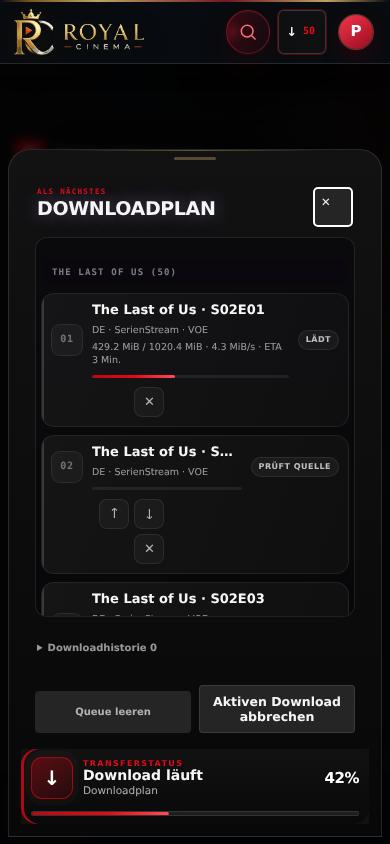
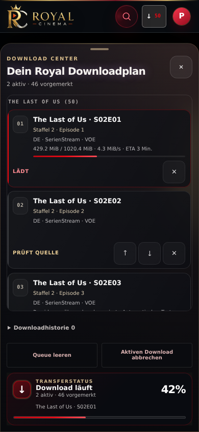

# Mobile Download Center 2.0

Base: `overnight` at `da5e5e72690facdb175d1540d2cb0a7618edbdf8`.

The mobile dock now provides a cinema sheet with a separate, blurred artwork layer,
compact queue cards, safe touch targets and a transfer footer. Desktop CSS and all
existing IDs, API routes, provider decisions, persistence and download operations
remain in place.

## Artwork and performance

Only the focused job's already-loaded catalog metadata is read. An exact episode
slug identifies its series; episode stills and unrelated selected series are not
used. The active download takes precedence, followed by source preparation and the
next planned item. Backdrop, poster and neutral gradients form the fallback chain.
There are no metadata/provider requests and no per-card image downloads.

Two decorative image elements crossfade only after successful load/decode. URL
identity suppresses reloads on progress updates, request generations reject stale
loads, and session disposal clears images and handlers. TMDB images use the
existing artwork policy at bounded `w500` resolution. A visible-sheet-only metadata
recheck accommodates late hydration without fetching metadata. Failed images keep
the neutral background and never become a queue error.

Episode badges use the verified episode slug; an existing matching title code
avoids a redundant metadata line. The mobile heading scales down on narrow
screens. The wallpaper gradient also has a worst-case white-artwork contrast
contract for the small header text (at least 4.5:1).

Queue nodes and their listeners are reused for unchanged card structure. Progress
updates look up the job directly. History rows are created only when expanded;
unchanged history snapshots retain their DOM. Controls preserve the existing
endpoints and retry/cancellation rules. Request buttons are re-enabled after the
request completes even if the response retains the same card node.

Mobile layout reserves space for metrics/progress, uses 44px action targets,
keeps destructive controls and transfer outside the list, and uses a scrolling
main section on short landscape/keyboard viewports. Reduced motion disables
sheet, artwork and progress animation. Keyboard focus stays inside the open sheet
and returns to its trigger when closed. Crossing the desktop breakpoint invokes
the existing close controller and transfers focus to the visible dock control. Unknown progress removes `aria-valuenow`
and uses source activity rather than a fabricated percentage.

## Reproducible renderings

The images below use the actual application with deterministic offline queue and
artwork fixtures; they are browser renderings, not a visual mockup. The artwork
fixture substitutes for a real poster so screenshots require no external account
or provider. Full Chromium and WebKit renderings at 320, 360, 390, 430, 768 and
1440px are generated as CI artifacts.

| Original mobile dock, 390px | Download Center, 390px |
| --- | --- |
|  |  |

Run the focused contract:

```bash
node --test tests/frontend/download-presentation.test.mjs
ROYAL_BROWSER=chromium node tests/frontend/download-center-browser.cjs
ROYAL_BROWSER=webkit node tests/frontend/download-center-browser.cjs
python -m pytest -q tests/test_download_dock_presentation.py
```

Set `ROYAL_DOWNLOAD_BASELINE` to the original checkout's `web` directory to also
capture before renderings. Existing Quality, browser, WebKit, performance,
CodeQL and offline Stability gates stay enabled with their existing thresholds.
The frozen CSS equivalence check applies the intentionally redesigned mobile
sheet styles to both sides; it still compares every desktop element and all other
mobile components. Dedicated Download Center checks protect the new sheet.

## Validation

Validation results and workflow links are recorded in the pull request. Do not
merge on the basis of screenshots or focused tests alone; a merge recommendation
requires successful full CI gates. No NAS deployment is part of this change.
